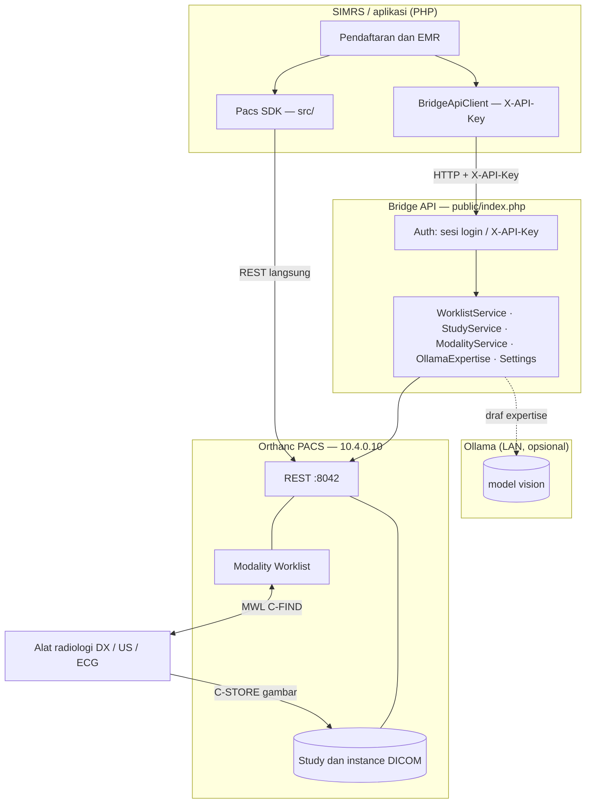
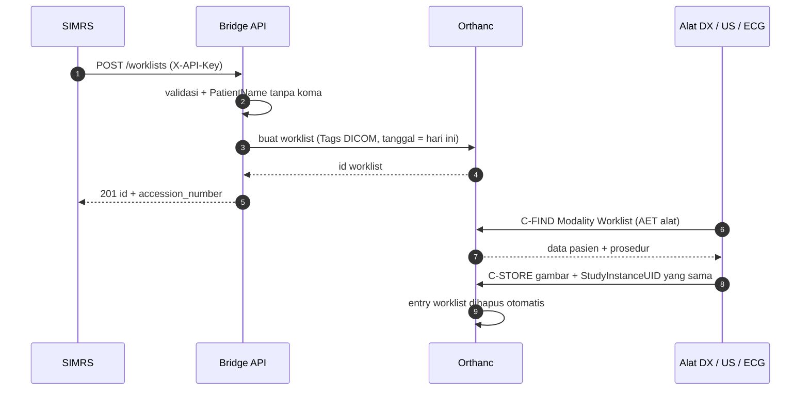
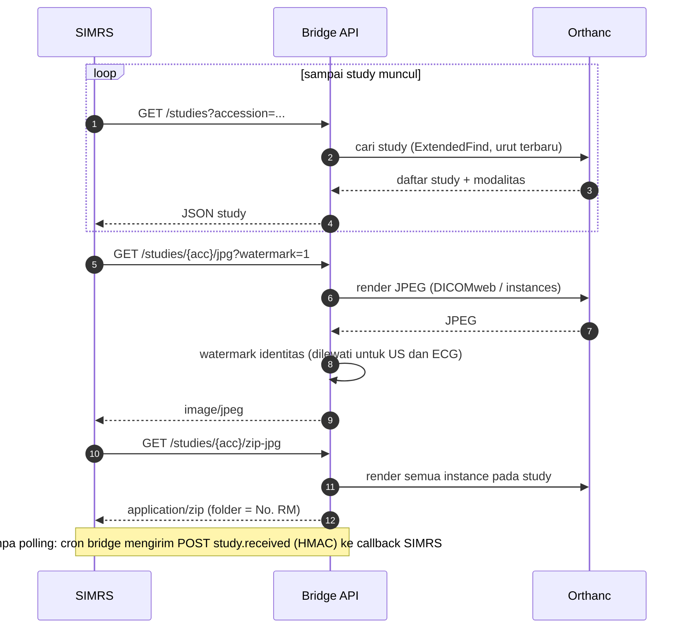

# Bridge SIMRS ↔ Orthanc PACS

Bridge PHP tanpa framework untuk menghubungkan **SIMRS** dengan server **Orthanc PACS**
(Modality Worklist DICOM + retrieval study/gambar). Mendukung semua kode modality DICOM
(**DX**, **CT**, **US**, **ECG**, **PX**, …) — nilai bawaan `DX`, bisa diubah per order.

**Isi:** [Fitur](#fitur) · [Alur program](#alur-program) · [Auto expertise](#auto-expertise-ai-opsional) ·
[Kebutuhan](#kebutuhan) · [Mulai cepat](#mulai-cepat) · [Dokumentasi](#dokumentasi) ·
[Contoh singkat](#contoh-singkat-program) · [Uji](#uji) · [Keamanan](#keamanan) · [Struktur](#struktur)

Alur lengkap (diagram Mermaid, otomatis dirender GitHub): lihat [Alur program](#alur-program).

## Fitur

### Worklist (MWL) & order

| Fitur | Endpoint utama |
|---|---|
| Kirim order pasien ke **worklist (MWL)** — **idempotent** per accession (`201` baru / `200` sudah ada / `409` accession milik pasien lain) | `POST /worklists` |
| Daftar, detail, ubah, dan hapus order | `GET /worklists`, `GET · PUT · DELETE /worklists/{id}` |
| **Status order** untuk petugas (terkirim / diproses / gambar masuk / dibatalkan) + timeline audit | `GET /worklists/{acc}/status` |
| Nomor `AccessionNumber` otomatis (format alat) | `GET /accession` |

### Study & gambar

| Fitur | Endpoint utama |
|---|---|
| Cari study (accession / No. RM / nama pasien) dan study terbaru per tanggal + modality | `GET /studies`, `GET /studies/recent` |
| Daftar gambar (instance) sebuah study | `GET /studies/{acc}/images` |
| Gambar **JPEG/PNG** (opsional ber-watermark identitas; USG & EKG tanpa watermark) | `/studies/{acc}/jpg`, `/png` |
| **ZIP** DICOM & ZIP berisi JPG (folder = No. RM) | `/studies/{acc}/zip`, `/zip-jpg` |
| Render / unduh satu instance | `GET /instances/{id}/jpg`, `GET /instances/{id}/file` |

### Dashboard web (`/`)

| Fitur | Keterangan |
|---|---|
| Statistik PACS | jumlah study, pasien, instance, dan order worklist |
| Form order baru | No. RM, gelar, accession otomatis, pemeriksaan, modality, AET alat; nama dinormalisasi tanpa koma |
| Daftar worklist | detail/ubah/hapus order + status order |
| Study & Gambar | pencarian, tab per modality (otomatis dari alat), filter **Hari ini / Semua tanggal**, viewer (zoom, pan, layar penuh), unduh JPG / ZIP JPG / ZIP DICOM, tombol **Draf AI** (bila Auto Expertise aktif) |
| Pengaturan (manager) | koneksi Orthanc, alat worklist (**Daftarkan ke Orthanc**, **Tes C-ECHO**), API bridge (generate/hapus + contoh curl/PHP/Python), callback, Auto Expertise (Ollama), akun saya, kelola user |
| Indikator status | status koneksi Orthanc, ketersediaan worklist, dan peringatan password masih default |

`public/dashboard.html` — tanpa build step; aset di `public/assets/`.

### Akses & keamanan

| Fitur | Endpoint utama |
|---|---|
| Login dashboard (peran **manager** / **operator**) + status sesi | `POST /login`, `GET /logout`, `GET /me` |
| **API key** untuk program (kirim header `X-API-Key`) | `GET /settings/api-key` (**manager**) |
| Ubah pengaturan (koneksi, alat, callback, Ollama) | `GET · PUT /settings` (PUT **manager**) |
| Ganti password akun sendiri | `POST /settings/password` |
| Kelola user dashboard (tambah, ubah peran, reset password, hapus) | `GET · POST /users`, `PUT · DELETE /users/{username}` (**manager**) |
| **Audit log** setiap request + event aksi penting, dibaca petugas | `data/audit.log` (rotasi 5 MB), `GET /audit` (**manager**) |

### Integrasi & operasional

| Fitur | Endpoint / alat |
|---|---|
| **Callback** `study.received` ke SIMRS (HMAC `X-Bridge-Signature`, at-least-once) | `tools/notify-studies.php` |
| Tarikan terjadwal study dari PACS sumber `SANTESRV1` (C-GET) | `tools/pull-santesrv1.php` |
| Daftarkan alat baru ke Orthanc + uji **C-ECHO** (tanpa edit `orthanc.json`) | `GET /modalities`, `PUT /modalities/{aet}`, `POST /modalities/{aet}/echo` |
| Health check Orthanc, worklist, dan versi bridge | `GET /health` |
| Adapter **CodeIgniter 3 & 4** (mode A lewat Bridge API / mode B langsung Orthanc) | `integrations/codeigniter/` |
| Koleksi uji manual & probe DICOM | `postman/`, `bridge.http`, `dicom-probe.py` |
| Deploy container + cron (container `pacs-bridge`) | `deploy/deploy.sh`, `deploy/README.md` |

### AI (opsional, LAN)

| Fitur | Endpoint utama |
|---|---|
| **Draf expertise AI** dari satu gambar study (model vision Ollama, wajib verifikasi dokter) | `POST · GET /studies/{key}/expertise` |
| Status server Ollama + model vision yang tersedia | `GET /ollama/status` |

## Alur program

Ringkasnya: **SIMRS mengirim order → Orthanc menyimpannya sebagai worklist → alat menarik order (C-FIND MWL)
→ alat mengirim gambar (C-STORE) → SIMRS mengambil render/ZIP lewat bridge.**

### 1. Peta komponen & dua cara memanggil



### 2. Alur kirim order (worklist MWL)



### 3. Alur ambil hasil (polling study → gambar)



### 4. Catatan alur

- Worklist bersifat **tarik** (alat C-FIND), bukan push dari server.
- `POST /worklists` idempotent per `AccessionNumber` (retry aman; `409` bila accession milik pasien lain).
- **Tanpa polling**: isi *Callback URL* + *Callback key* di Pengaturan → bridge mengirim
  `POST study.received` (HMAC `X-Bridge-Signature`) saat study baru stabil.
- **Auto expertise (opsional)**: `POST /studies/{key}/expertise` membuat draf bacaan dari satu gambar
  study lewat model vision Ollama di LAN; hasil disimpan sebagai draf dan wajib diverifikasi dokter.
- Status order (`sent` / `taken` / `completed` / `cancelled`) tersedia di `GET /worklists/{acc}/status`.
- Semua panggilan tercatat di audit log (`data/audit.log`, `GET /audit` untuk manager).
- Alat mengirim gambar via C-STORE; entry worklist dihapus Orthanc setelah study stabil diterima.
- Bridge **stateless** untuk gambar — render/arsip selalu diambil ulang dari Orthanc.
- Kunci `{acc}` fleksibel: AccessionNumber, ID Orthanc, atau StudyInstanceUID (berguna untuk study USG tanpa accession).
- Endpoint data butuh **sesi login** atau **`X-API-Key`**; lihat [docs/API-KEY-SIMRS.pdf](docs/API-KEY-SIMRS.pdf).

## Auto expertise (AI, opsional)

Draf bacaan otomatis untuk satu study memakai model **vision Ollama** di jaringan lokal:

```bash
KEY="<API_KEY>"
curl -H "X-API-Key: $KEY" http://127.0.0.1:8081/ollama/status                  # reachable + model vision
curl -X POST -H "X-API-Key: $KEY" http://127.0.0.1:8081/studies/A261105038/expertise
curl -H "X-API-Key: $KEY" http://127.0.0.1:8081/studies/A261105038/expertise    # draf tersimpan
```

- Nonaktif secara bawaan (`ollama_enabled=false`); aktifkan di **Pengaturan → Auto Expertise (Ollama)**.
- Server & model diatur lewat `ollama_url` / `ollama_model` (bawaan `qwen3.5:9b`) atau env `PACS_OLLAMA_*`.
- Yang dikirim ke model: render PNG 1024px **tanpa watermark**, hanya ke Ollama di LAN — tidak ke internet.
- Draf disimpan di `data/expertise/{key}.json` dan **wajib diverifikasi dokter**; bukan diagnosis.

## Kebutuhan

- PHP **8.2+** dengan ekstensi `curl`, `json`, `mbstring` (opsional `gd` + FreeType untuk watermark)
- Tanpa Composer / tanpa framework
- Orthanc PACS yang dapat dijangkau (REST + DICOM MWL)
- Opsional: server **Ollama** (LAN) untuk draf expertise AI
- Opsional: Docker (lihat `Dockerfile` & `deploy/`)

## Mulai cepat

```powershell
# 1) konfigurasi koneksi
notepad setting.txt        # IP/AET/port server Orthanc

# 2) jalankan API (router wajib: path ber-titik seperti UID DICOM)
php -S 0.0.0.0:8081 -t public public/router.php
#    buka http://127.0.0.1:8081/  (login awal: admin / admin)

# 3) di dashboard: ⚙ Pengaturan → aktifkan API key, lalu daftarkan alat di panel Alat Worklist
```

Di Laragon: arahkan docroot ke folder `public/`.

Konfigurasi bisa dioverride lewat environment:
`PACS_SERVER_IP`, `PACS_HTTP_PORT`, `PACS_DICOM_PORT`, `PACS_CALLED_AET`, `PACS_CALLING_AET`,
`PACS_MODALITY`, `PACS_HTTP_USER`, `PACS_HTTP_PASS`, `PACS_BRIDGE_KEY`, `PACS_TIMEOUT`, `PACS_TIMEZONE`,
`PACS_WATERMARK_FONT`, `PACS_CALLBACK_URL`, `PACS_CALLBACK_KEY`,
`PACS_OLLAMA_ENABLED`, `PACS_OLLAMA_URL`, `PACS_OLLAMA_MODEL`, `PACS_OLLAMA_TIMEOUT`.

## Dokumentasi

| Dokumen | Isi |
|---|---|
| [`API.md`](API.md) | referensi REST API: autentikasi, endpoint, contoh respons, contoh konek |
| [`docs/API-KEY-SIMRS.pdf`](docs/API-KEY-SIMRS.pdf) | **panduan API key untuk tim SIMRS** (cetak, sumber [`docs/API-KEY-SIMRS.html`](docs/API-KEY-SIMRS.html)): tabel endpoint ✅/❌, mode integrasi CI (`PacsApi`/`Pacs_api` vs langsung), error, checklist go-live |
| [`integrations/codeigniter/README.md`](integrations/codeigniter/README.md) | library CodeIgniter 3 & 4 — **mode API** (lewat bridge, `X-API-Key`) atau langsung ke Orthanc |
| [`PACS-ORTHANC.md`](PACS-ORTHANC.md) | catatan teknis server PACS (temuan & quirk) |
| [`AGENTS.md`](AGENTS.md) | aturan kerja developer/agent (ringkas; detail di `docs/REF-*.md`) |
| [`docs/REF-API.md`](docs/REF-API.md), [`REF-DASHBOARD.md`](docs/REF-DASHBOARD.md), [`REF-OPERASIONAL.md`](docs/REF-OPERASIONAL.md), [`REF-CI.md`](docs/REF-CI.md), [`REF-DEPLOY.md`](docs/REF-DEPLOY.md), [`REF-LINGKUNGAN.md`](docs/REF-LINGKUNGAN.md) | rujukan detail per topik (dibaca sesuai kebutuhan) |
| [`deploy/README.md`](deploy/README.md) | deploy container + cron tarikan study |

## Contoh singkat (program)

```bash
KEY="<API_KEY>"
curl -H "X-API-Key: $KEY" http://127.0.0.1:8081/health

curl -X POST http://127.0.0.1:8081/worklists \
  -H "X-API-Key: $KEY" -H "Content-Type: application/json" \
  -d '{"patient_name":"TARYA BIN WARDI","title":"Tn.","patient_id":"A048919",
       "accession_number":"A261105038","procedure":"THORAX PA","station_aet":"LEAD_CLIENT"}'

curl -H "X-API-Key: $KEY" "http://127.0.0.1:8081/studies/A261105038/jpg?quality=90" -o hasil.jpg
curl -H "X-API-Key: $KEY" "http://127.0.0.1:8081/worklists/A261105038/status"
```

Semua endpoint **kecuali** `/login`, `/logout`, `/me`, dan halaman dashboard memerlukan
**sesi login** atau header **`X-API-Key`**. Endpoint konfigurasi/user hanya untuk manager.

## Uji

```powershell
php tools/selftest.php                    # end-to-end (membuat lalu menghapus entry uji)
php tools/test-order-flow.php http://127.0.0.1:8081 <API_KEY>   # idempotensi, 409, status order, audit
php tools/test-ci-integration.php         # library CI3 + CI4
php tools/test-api-key.php http://127.0.0.1:8081 <API_KEY>
php tools/test-users.php   http://127.0.0.1:8081 admin admin
php tools/test-expertise.php http://127.0.0.1:8081 <API_KEY>    # auto expertise (Ollama aktif)
python dicom-probe.py 10.4.0.10 4242 ORTHANC LEAD_CLIENT   # C-ECHO / MWL / C-FIND
```

Target semua skrip **0 fail** (jumlah pass & prasyarat env ada di [`AGENTS.md`](AGENTS.md) §6).
Skrip uji membuat lalu menghapus datanya sendiri — jangan sampai meninggalkan order/user uji.

## Keamanan

- **Jangan commit kredensial.** `data/settings.json` (hash password + API key) dan
  `http-client.env.json` sudah dikecualikan di `.gitignore`.
- **Aktifkan API key** di dashboard (⚙ Pengaturan → panel *API Bridge*) sebelum bridge diekspos
  ke jaringan: tanpa key atau sesi, endpoint data menjawab `401`.
- Batasi akses ke LAN/VPN dan gunakan **HTTPS** bila melewati jaringan luar.
- Orthanc pada instalasi internal bisa berjalan tanpa autentikasi REST — batasi portnya di level jaringan.
- Gambar JPG/PNG hasil render adalah **preview** (lossy, 8-bit), bukan citra diagnostik.
- **Auto expertise** mengirim render gambar ke server Ollama di LAN — jangan arahkan `ollama_url` ke
  layanan publik, dan perlakukan hasilnya sebagai **draf** yang harus diverifikasi dokter.

## Struktur

```
public/        REST API (index.php), dashboard, router dev, aset
src/           SDK Simrs\Pacs: Config, OrthancClient, WorklistService, StudyService, ModalityService,
               WatermarkService, OllamaExpertise, ZipWriter, Auth, Settings, AuditLogger, Bridge, BridgeApiClient
integrations/  adapter CodeIgniter 3 & 4 (mode API lewat bridge / langsung Orthanc)
tools/         self-test (order, user, API key, expertise), penarik study terjadwal, worker callback, agent-map
docs/          rujukan REF-*.md + panduan API key tim SIMRS (PDF + HTML)
deploy/        skrip deploy, cron, stack Orthanc (compose + systemd + nginx)
data/          runtime: settings.json, audit.log, expertise/ (tidak di-commit)
sessions/      runtime: sesi login PHP (dibuat otomatis, tidak di-commit)
setting.txt    konfigurasi client (IP/AET/port)
Dockerfile     image produksi (php:8.3-apache)
postman/       koleksi + environment Postman
bridge.http    contoh request REST Client
dicom-probe.py uji C-ECHO / MWL / C-FIND
```
